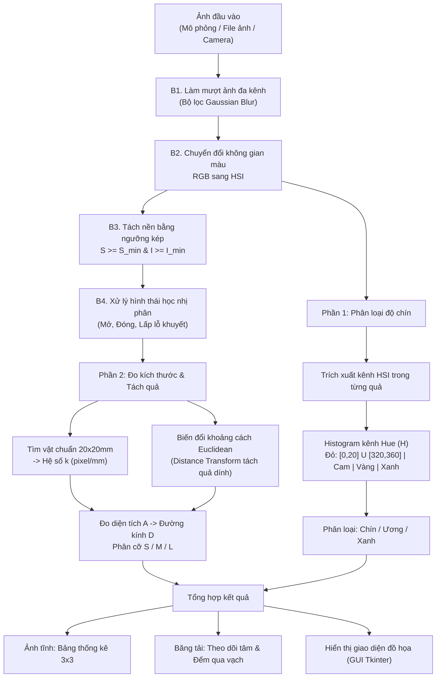
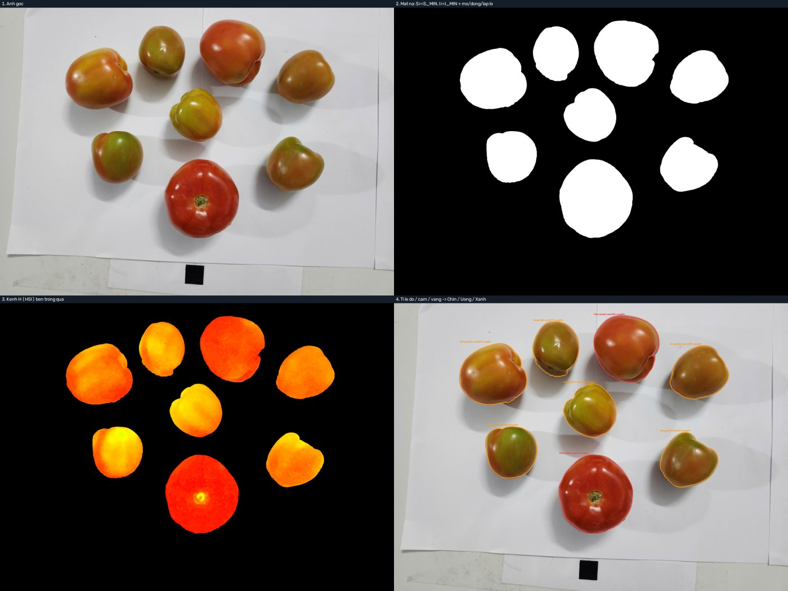
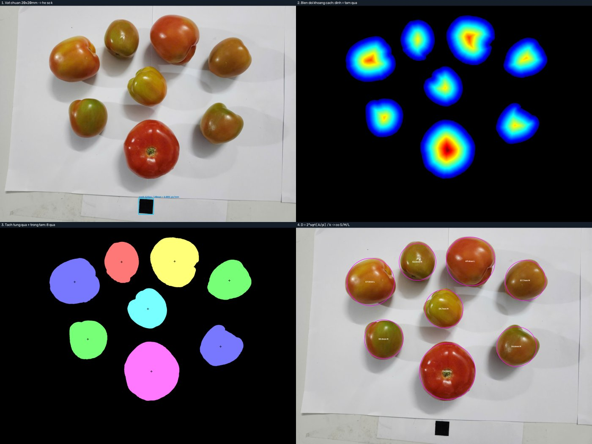
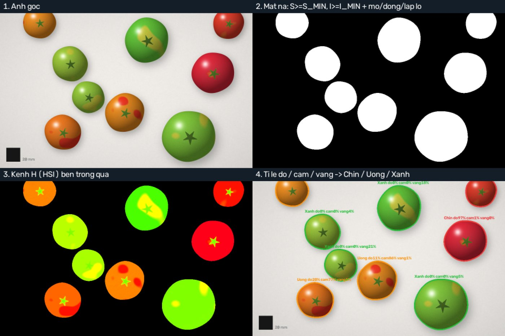
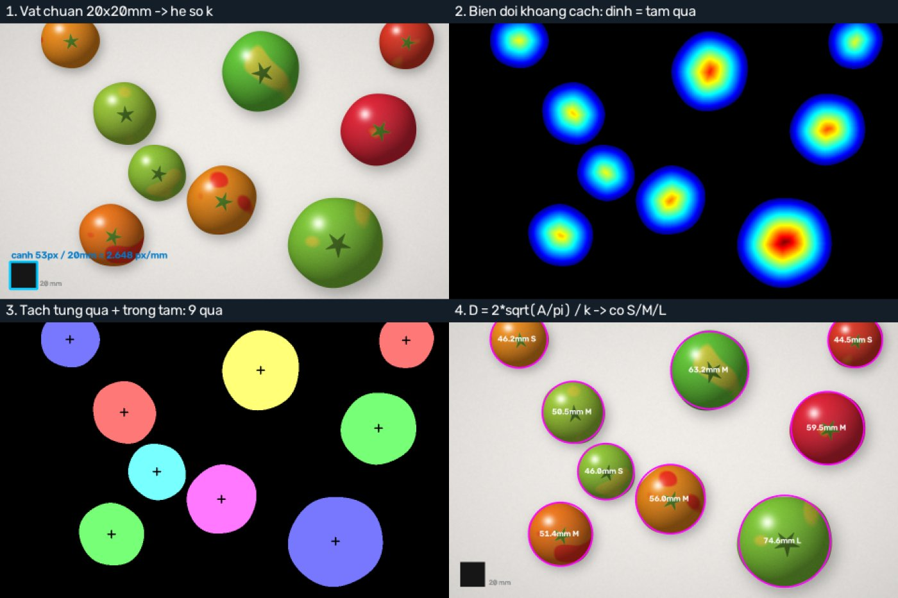

# Hệ Thống Phân Loại Độ Chín, Đo Kích Thước Và Đếm Cà Chua Bằng Xử Lý Ảnh

[](https://www.python.org/)
[](https://opencv.org/)
[](https://numpy.org/)
[](LICENSE)

Dự án ứng dụng các kỹ thuật thị giác máy tính và thuật toán xử lý ảnh kinh điển để tự động hóa quy trình phân loại chất lượng nông sản (cà chua): nhận diện độ chín, tính toán kích thước thực tế theo milimét (mm), phân cỡ và đếm số lượng trên cả ảnh tĩnh, băng tải mô phỏng lẫn camera thời gian thực.

> *** A classical computer-vision pipeline (no deep learning) written in Python/OpenCV that classifies tomato ripeness in the HSI colour space, measures fruit diameter in millimetres using a 20×20 mm reference square, grades size (S/M/L) and counts fruits on still images, a simulated conveyor belt and live camera/video streams. Includes a Tkinter GUI and a reproducible benchmark on synthetic data with ground truth.

---

## 1. Mô Tả Bài Toán

Trong dây chuyền chế biến và đóng gói nông sản, khâu phân loại thủ công bộc lộ nhiều hạn chế về năng suất, tính đồng đều và độ chính xác. Đề tài tập trung giải quyết 3 bài toán trọng tâm:

1. **Phân loại độ chín:**
   - Phân chia cà chua thành 3 mức độ: **Chín** (Đỏ), **Ương** (Cam/Vàng) và **Xanh** (Xanh lá).
   - Phương pháp: Không gian màu RGB dễ bị ảnh hưởng bởi cường độ ánh sáng, do đó hệ thống chuyển đổi ảnh sang không gian màu **HSI** (*Hue - Saturation - Intensity*) và phân tích phân bố Histogram của kênh góc màu **Hue ($H$)** trên từng quả.

2. **Đo kích thước & Phân cỡ thương phẩm:**
   - Chuyển đổi kích thước từ đơn vị pixel sang kích thước thực tế **milimét (mm)** nhờ một **vật chuẩn tham chiếu** đã biết trước kích thước (ô vuông màu đen $20 \times 20\text{ mm}$).
   - Tách cụm các quả nằm sát nhau hoặc đè chạm nhau bằng giải thuật biến đổi khoảng cách (**Distance Transform**).
   - Tính toán diện tích vùng quả $A$ và suy ra đường kính hình học tương đương:

     $$D = 2 \times \sqrt{\frac{A}{\pi}}$$

   - Phân loại theo 3 tiêu chuẩn kích cỡ thương mại:
     - **Cỡ S** (*Small*): $D < 50\text{ mm}$
     - **Cỡ M** (*Medium*): $50\text{ mm} \le D \le 65\text{ mm}$
     - **Cỡ L** (*Large*): $D > 65\text{ mm}$

3. **Đếm số lượng tự động:**
   - **Đếm trên ảnh tĩnh:** Tổng hợp ma trận thống kê $3 \times 3$ (3 mức độ chín $\times$ 3 kích cỡ).
   - **Đếm trên băng tải chuyển động:** Theo dõi trọng tâm quả qua từng khung hình (Tracking) và ghi nhận vào bộ đếm duy nhất khi tâm quả cắt qua vạch kiểm đếm quy định, triệt tiêu hiện tượng đếm trùng lặp.

---

## 2. Sơ Đồ Kiến Trúc & Quy Trình Xử Lý

### Sơ đồ luồng dữ liệu (Processing Pipeline)



### Nguyên lý giải thuật chi tiết

| Bước | Mục tiêu | Thuật toán / Công thức toán |
| :--- | :--- | :--- |
| **Làm mượt (Smoothing)** | Khử nhiễu ngẫu nhiên, giữ mịn biên quả | Ma trận Gaussian 2D $G(x,y) = \frac{1}{2\pi\sigma^2} e^{-\frac{x^2+y^2}{2\sigma^2}}$ tự sinh, nhân chập riêng rẽ trên 3 kênh R, G, B. |
| **Không gian HSI** | Tách biệt độ chói (Intensity) và màu sắc (Hue, Saturation) | $H = \arccos\left(\frac{(R-G) + (R-B)}{2\sqrt{(R-G)^2 + (R-B)(G-B)}}\right)$; $S = 1 - \frac{3\min(R,G,B)}{R+G+B}$; $I = \frac{R+G+B}{3}$. |
| **Tách nền (Thresholding)** | Tách quả và vật chuẩn khỏi nền trắng | Phân đoạn theo ngưỡng: $S \ge S_{min} = 55/255$ và $I \ge I_{min} = 22/255$ (loại bỏ ô vật chuẩn màu đen). |
| **Hình thái học (Morphology)** | Bịt lỗ rỗng do vệt sáng phản chiếu, tẩy sạch nhiễu | Phép co $A \ominus B$, giãn $A \oplus B$, mở $A \circ B$, đóng $A \bullet B$ với phần tử cấu trúc elip $5 \times 5$, kết hợp thuật toán lấp lỗ biên. |
| **Tách cụm quả chạm nhau** | Tách riêng các quả dính thành từng cá thể | Biến đổi khoảng cách Euclidean (Distance Transform) tính khoảng cách từ điểm trắng tới mép đen gần nhất; các cực đại cục bộ đóng vai trò là tâm quả. |
| **Xác định hệ số tỉ lệ $k$** | Quy đổi pixel sang mm | Phát hiện ô vuông đen bằng phân ngưỡng $I < 0.5 \times \text{median}(I)$; $k = \frac{\sqrt{A_{\text{ref}}}}{20\text{ mm}}$ (pixel/mm). |
| **Phân loại độ chín** | Xác định trạng thái thu hoạch | Tỉ lệ điểm ảnh đỏ $\ge 60\% \rightarrow$ **Chín**; Tỉ lệ (Đỏ + Cam + Vàng) $\ge 50\% \rightarrow$ **Ương**; Còn lại $\rightarrow$ **Xanh**. |

---

## 3. Minh Họa Quy Trình Xử Lý

Mỗi module có chế độ trực quan hóa 4 giai đoạn trung gian. Ảnh dưới đây chạy trên ảnh chụp thật `picture/picture_test_3.jpg` (8 quả cà chua và 1 ô vuông chuẩn $20 \times 20\text{ mm}$).

### Phần 1: Tách nền & phân loại độ chín
1. **Ảnh gốc.**
2. **Mặt nạ nhị phân:** lọc ngưỡng kênh $S$ và $I$, sau đó mở/đóng/lấp lỗ.
3. **Kênh H bên trong quả:** bản đồ góc màu Hue (đỏ, cam, vàng, xanh).
4. **Kết quả phân loại:** viền quả và nhãn Chín/Ương/Xanh kèm tỉ lệ đỏ/cam/vàng.



### Phần 2: Đo kích thước & tách quả
1. **Phát hiện vật chuẩn** để tính hệ số $k$ (pixel/mm).
2. **Bản đồ Distance Transform:** đỉnh khoảng cách ứng với tâm quả.
3. **Tách từng quả và xác định trọng tâm.**
4. **Đường kính $D$ (mm) và nhãn cỡ S/M/L** trên từng quả.



### Chạy trên dữ liệu mô phỏng (có đáp án)




---

## 4. Cấu Trúc Thư Mục

```text
Tomato_classification/
├── picture/                           # Tài nguyên ảnh, logo và video mẫu thử nghiệm
│   ├── logo_hcmute.png                # Logo trường đại học
│   ├── logo_ute.png                   # Logo khoa / trường
│   ├── banh_xe_mau.png                # Vòng tròn màu HSI minh họa giải thuật
│   ├── picture_test_1.jpg ... 6.jpg   # Ảnh chụp cà chua thực nghiệm mẫu
│   └── video_test_1.mp4               # Video quay mẫu dòng cà chua di chuyển
├── docs/                              # Ảnh minh họa dùng trong README
├── main.py                            # Ứng dụng giao diện chính (Tkinter GUI Dashboard)
├── main_screen.py                     # Màn hình bìa khởi động (Splash Screen)
├── part_1_classification.py           # Module: Tiền xử lý, tách nền & phân loại độ chín
├── part_2_measuring_and_counting.py   # Module: Đo kích thước mm, phân cỡ & đếm số lượng
├── part_3_simulation.py               # Module: Giả lập dữ liệu mô phỏng & Benchmark định lượng
├── requirements.txt                   # Danh sách thư viện Python phụ thuộc
├── .gitignore                         # Danh sách file và thư mục loại trừ khi push Git
├── LICENSE                            # Giấy phép mã nguồn mở MIT
└── README.md                          # Tài liệu hướng dẫn kỹ thuật của dự án
```

---

## 5. Hướng Dẫn Cài Đặt & Sử Dụng

### Yêu cầu tiên quyết
- **Python:** `3.9` trở lên. Mã nguồn được chạy kiểm thử trên Python 3.13 (OpenCV 5.0, NumPy 2.5).
- **Thư viện:** `opencv-python >= 4.8.0`, `numpy >= 1.24.0` (xem `requirements.txt`). Tkinter đi kèm Python trên Windows và macOS.

### Cài đặt thư viện
Clone repository về máy và cài đặt các phụ thuộc thông qua file `requirements.txt`:

```bash
git clone https://github.com/username/Tomato_classification.git
cd Tomato_classification
pip install -r requirements.txt
```

> **Lưu ý đối với hệ điều hành Linux (Ubuntu/Debian):**  
> Cài đặt thêm module đồ họa Tkinter của Python nếu chưa có:  
> `sudo apt-get install python3-tk`

---

### Khởi chạy chương trình

#### 1. Khởi chạy toàn bộ hệ thống (Giao diện đồ họa đầy đủ)
```bash
python main.py
```
- Màn hình khởi động xuất hiện $\rightarrow$ Bấm nút **START** để truy cập bàn làm việc chính.
- **Phím tắt nhanh trên bàn phím:**
  - `N`: Tạo kịch bản ảnh mô phỏng ngẫu nhiên mới.
  - `B`: Bắt đầu / Dừng vận hành băng tải mô phỏng.
  - `Space` (Phím cách): Tạm dừng / Tiếp tục luồng xử lý video hoặc camera.

#### 2. Kiểm thử độc lập Module 1 (Phân loại độ chín)
```bash
# Chạy với dữ liệu mô phỏng ngẫu nhiên
python part_1_classification.py

# Hoặc kiểm thử trên một file ảnh thực tế
python part_1_classification.py picture/picture_test_1.jpg
```

#### 3. Kiểm thử độc lập Module 2 (Đo kích thước & Đếm)
```bash
# Chạy mô phỏng tình huống nhiều quả chạm dính nhau
python part_2_measuring_and_counting.py

# Hoặc kiểm thử trên ảnh thực tế có kèm vật chuẩn
python part_2_measuring_and_counting.py picture/picture_test_1.jpg
```

#### 4. Đánh giá định lượng hàng loạt (Benchmark toàn bộ hệ thống)
```bash
python part_3_simulation.py
```
Lệnh sẽ tự động chạy kiểm thử trên **600 quả** (60 ảnh tĩnh với 4 điều kiện môi trường) và **10 video băng tải**, xuất kết quả ra màn hình và lưu file tổng hợp `ket_qua_danh_gia.csv`.

#### 5. Thử nghiệm với Camera và Video thực tế
- **File video mẫu:** Tại ô địa chỉ Camera, nhập đường dẫn file video mẫu có sẵn trong repo: `picture/video_test_1.mp4` rồi bấm **Kết nối**.
- **Webcam tích hợp:** Nhập số `0` hoặc `1` rồi bấm **Kết nối**.
- **Camera điện thoại (IP Camera):** Mở app DroidCam hoặc IP Webcam trên điện thoại (chung mạng Wi-Fi với máy tính), nhập `http://<IP_DIEN_THOAI>:4747/video` (DroidCam) hoặc `http://<IP_DIEN_THOAI>:8080/video` (IP Webcam) rồi bấm **Kết nối**.

---

## 6. Kết Quả Thực Nghiệm & Đánh Giá Định Lượng

> **Lưu ý quan trọng:** các số liệu dưới đây được đo trên **dữ liệu mô phỏng tự sinh có đáp án (ground truth)** bằng `part_3_simulation.py` (cố định `seed`, chạy lại sẽ ra cùng kết quả). Đây là đánh giá thuật toán trong điều kiện được kiểm soát, **không phải độ chính xác ngoài thực tế**.

### Ảnh tĩnh: 60 ảnh, 600 quả

| Điều kiện thử nghiệm | Số quả | Đếm đúng | Đúng độ chín | Đúng cỡ S/M/L | Sai số đường kính TB | Sai số lớn nhất |
| :--- | :---: | :---: | :---: | :---: | :---: | :---: |
| Điều kiện chuẩn | 150 | 100.0% | 99.3% | 100.0% | 0.14 mm | 0.29 mm |
| Thiếu sáng (độ sáng 60%) | 150 | 100.0% | 99.3% | 100.0% | 0.14 mm | 0.29 mm |
| Nhiễu Gaussian ($\sigma = 20$) | 150 | 100.0% | 99.3% | 100.0% | 0.13 mm | 0.43 mm |
| Quả chạm nhau | 150 | 100.0% | 98.7% | 99.3% | 0.15 mm | 1.28 mm |
| **Tổng** | **600** | **100.0%** | **99.2%** | **99.8%** | **0.14 mm** | **1.28 mm** |

### Băng tải mô phỏng: 10 video, 100 quả
- Đếm qua vạch: **100/100** quả (sai số đếm 0%).
- Đúng đồng thời độ chín và kích cỡ: **97.0%**.

### Tốc độ xử lý
Đo trên máy ảo 2 nhân (Intel Xeon 2.1 GHz, không GPU), Python 3.13:
- Ảnh tĩnh mô phỏng: khoảng 38 ảnh/giây.
- Băng tải mô phỏng (tính cả thời gian sinh khung hình): khoảng 54 khung/giây.

Tốc độ phụ thuộc phần cứng và độ phân giải ảnh. Giao diện `main.py` hiển thị tốc độ thực tế trên máy của bạn.

### Ảnh chụp thật
Sáu ảnh `picture/picture_test_1..6.jpg` chỉ để minh họa và chưa có đáp án gán nhãn thủ công, nên README không đưa ra độ chính xác cho tập này. Hệ thống phát hiện lần lượt 13, 13, 8, 4, 4 và 8 quả; bạn có thể tự kiểm tra bằng:

```bash
python part_2_measuring_and_counting.py picture/picture_test_3.jpg
```

Để tái hiện toàn bộ bảng trên: `python part_3_simulation.py` (khoảng 1 phút).

---

## 7. Hạn Chế

- Giả định **nền giấy trắng**, vật chuẩn là **ô vuông đen 20 × 20 mm** nằm trong khung hình và cùng mặt phẳng với quả.
- Ngưỡng $S_{min}$, $I_{min}$ được chọn bằng thực nghiệm trên bộ dữ liệu thử nghiệm; đổi ánh sáng hoặc màu nền mạnh có thể cần chỉnh lại.
- Đường kính tính theo giả định quả gần tròn, nhìn từ trên xuống; quả dẹt hoặc méo sẽ có sai số lớn hơn.
- Tách quả dính bằng Distance Transform hiệu quả với 2 đến 3 quả chạm nhau, chưa xử lý tốt khi nhiều quả chồng lên nhau.
- Kết quả định lượng chủ yếu trên dữ liệu mô phỏng; chưa có đánh giá có gán nhãn trên ảnh và video thật.
- Các phương pháp thuần xử lý ảnh cổ điển, không dùng học sâu.

---

## 8. Giấy Phép & Thông Tin Đề Tài

Đề tài môn **Xử lý ảnh**, Trường Đại học Sư phạm Kỹ thuật TP.HCM (HCMUTE).

Mã nguồn phân phối theo giấy phép [MIT](LICENSE), phục vụ mục đích học tập và nghiên cứu.
